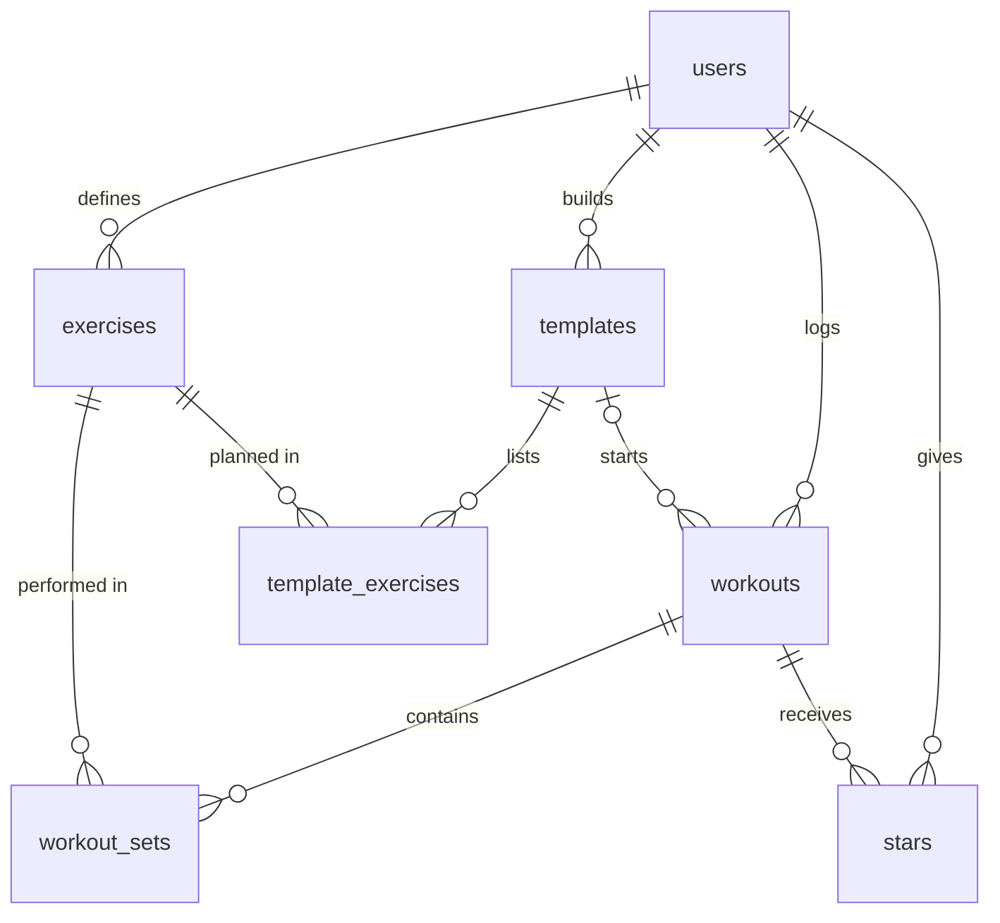

# Barbook: Plan

## 1. Pitch

I'm building Barbook, a free training log for powerlifters, because since I stopped competing I've lost the coaching apps that built my workouts and suggested my numbers, and my training now lives in disparate systems that don't help me. I don't want to pay for an app, and I want one that's accessible: free for anyone, and easy to use on a phone between sets.

**How often I'll use it:** every training session.

## 2. Features

In build order. Features 1–7 are the required spine; 8–10 are my own.

1. **Sign up and login.** As a lifter, I want to create an account, log in, and log out, so that my training history is mine alone.
2. **Data model.** As a lifter, I want my workouts, exercises, and sets stored in connected tables, so that every set is tied to a lift and a date.
3. **Workout CRUD.** As a lifter, I want to add a workout, see my list of workouts, open one to see its sets, edit it, and delete it after an "are you sure?" confirmation, so that my log stays accurate.
4. **Validation.** As a lifter, I want a friendly message if I leave out a workout's title or date, or a set's exercise, weight, or reps, so that I don't save a log I can't use later.
5. **Stars.** As a lifter, I want to star a workout and see a "starred" view, so that I can quickly find my best days and sessions worth repeating.
6. **Find things.** As a lifter, I want to search workouts by title, filter them by exercise, and sort them by newest, oldest, or highest volume, so that I can find when I last did something.
7. **Dashboard.** As a lifter, I want to see a chart of estimated 1-rep max over time for squat, bench, and deadlift, plus my workouts this month, volume over the last 30 days, and best estimated total, so that I can tell whether I'm getting stronger.
8. **Program templates.** As a lifter, I want to build a reusable template (exercises with target sets, reps, and RPE) and start a workout from it, so that I can program my training the way my coaches did.
9. **Suggested weights.** As a lifter, I want a suggested weight for each exercise when I start a workout from a template, based on my last top set, so that I don't have to work out my numbers by hand.
10. **CSV import.** As a lifter, I want to upload a CSV of past workouts, so that I can bring my scattered history into one place.

**How suggestions work (feature 9).** Take the heaviest working set from the last time I did the exercise:

- Reps to failure = reps + (10 − RPE). If RPE wasn't logged, treat it as 10.
- Estimated 1-rep max = weight × (1 + reps to failure ÷ 30). A true single at RPE 10 is just its weight.
- Suggested weight = estimated 1-rep max ÷ (1 + (target reps + 10 − target RPE) ÷ 30), rounded to the nearest 5 lb.
- If that isn't above the last weight and the last set's RPE was at or below target, add 5 lb.

For a target of 5 reps at RPE 8: 300×5 @ RPE 8 suggests 305, and 300×5 @ RPE 9 suggests 290. A suggestion is only a pre-filled value that I can overwrite. It always shows the set it came from. With no history, it shows no suggestion.

## 3. Database

Every table's primary key is `id` (text for `users`, a generated text ID elsewhere) except `stars`. Weights are in pounds.

| Table | Columns (type) |
|---|---|
| **users** | `id` (text, PK), `email` (text), `name` (text), `created_at` (date). Created by the auth service. |
| **exercises** | `id` (PK), `user_id` (text, FK), `name` (text), `category` (text: squat, bench, deadlift, accessory), `created_at` (date). Name is unique per user. |
| **workouts** | `id` (PK), `user_id` (text, FK), `template_id` (text, FK, optional), `title` (text), `performed_on` (date), `bodyweight` (number, optional), `notes` (text, optional), `created_at` (date) |
| **workout_sets** | `id` (PK), `user_id` (text, FK), `workout_id` (text, FK), `exercise_id` (text, FK), `set_number` (number), `weight` (number), `reps` (number), `rpe` (number, 6–10, optional), `is_warmup` (true/false) |
| **stars** | `user_id` (text, FK), `workout_id` (text, FK), `created_at` (date). PK is `user_id` + `workout_id` together, so a workout can't be starred twice. |
| **templates** | `id` (PK), `user_id` (text, FK), `name` (text), `notes` (text, optional), `created_at` (date) |
| **template_exercises** | `id` (PK), `user_id` (text, FK), `template_id` (text, FK), `exercise_id` (text, FK), `position` (number), `target_sets` (number), `target_reps` (number), `target_rpe` (number, optional) |

**How they connect**

- A user has many workouts, exercises, and templates (one-to-many).
- A workout has many sets, and an exercise appears in many sets (one-to-many each). Together, `workout_sets` connects workouts and exercises many-to-many.
- Users and workouts are also many-to-many through `stars`.
- A template has many template exercises, and a workout can optionally come from one template.

## 4. Tests

- **Data isolation.** Given User A has logged a workout, when User B logs in and requests the workouts list or that workout's direct link, then User B sees an empty list and no workout.
- **Dashboard.** Given I logged working sets of 100×5 and 120×3 and a warm-up of 60×5 in the last 30 days, when the dashboard calculates 30-day volume, then it shows 860 (500 + 360, with the warm-up excluded).

## 5. Technologies

- **Coding agent: Claude Code.** It works directly with my files, Git, and GitHub, which suits the Issue, branch, and PR loop.
- **Database: Neon Postgres with Row Level Security.** It has a free tier, and the database itself blocks one user from reading another's rows, even if the app has a bug.
- **Sign up and login: Neon Managed Better Auth, with email and password.** It's built into Neon, and I've already used it on a previous project.
- **Hosting: Vercel.** It's free for a project this size and can redeploy whenever a PR merges to `main`, which keeps the live URL current.
- **Framework: Next.js with TypeScript.** It handles pages and server logic in one project, and the types catch mistakes in the data.
- **Styling: Tailwind and shadcn/ui.** They provide ready-made components built on accessible primitives.
- **Recharts** draws the dashboard chart without my having to write chart code from scratch.
- **Zod** defines validation rules once, so messages stay consistent.
- **Papa Parse** reads CSV files reliably, including awkward quoting.
- **Vitest** runs the two required tests.

## 6. Design

**Look and feel:** a dark, plain, high-contrast logbook that's easy to read in a dim gym. Charcoal background (`#16181C`), chalk-white text (`#F2F0EA`), and one competition-red accent (`#E5484D`) for primary actions and PRs, plus a light theme. Numbers are large and take priority over decoration.

**Mobile first and accessible:** it's designed for one hand on a phone between sets, with tap targets of at least 44px, numeric keypads for weight and reps, text contrast meeting WCAG AA, full keyboard support, and labels on every field.

**Inspiration:** Hevy and Strong, for their fast set-by-set logging.

## 7. Risks and cuts

**Least sure I can build:** CSV import. Every old log has different columns and date formats, and a bad import could fill my log with wrong data. To contain that, it accepts one documented column format, shows a preview, and imports nothing if any row is invalid.

**Other risk:** suggested weights are only as good as the RPE I log, so they stay as editable suggestions, with their source shown.

**What I'll cut first, in order:**

1. CSV import. I'd enter my history by hand, and the app would still have 9 features, above the 8-feature minimum, but I'd need a smaller replacement to keep my required 3 custom features.
2. The light theme.
3. Filtering by exercise, keeping title search and sort, which still meets the requirement.
