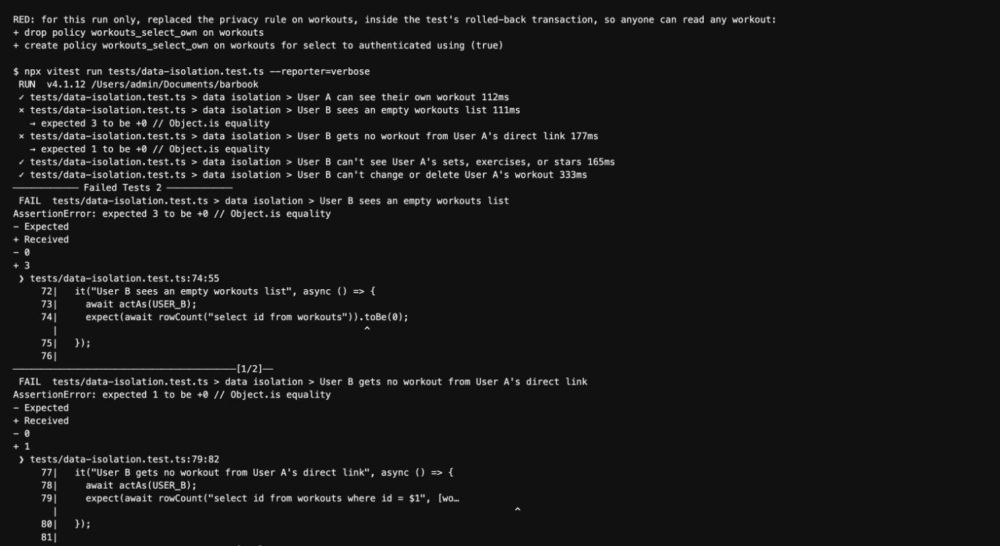
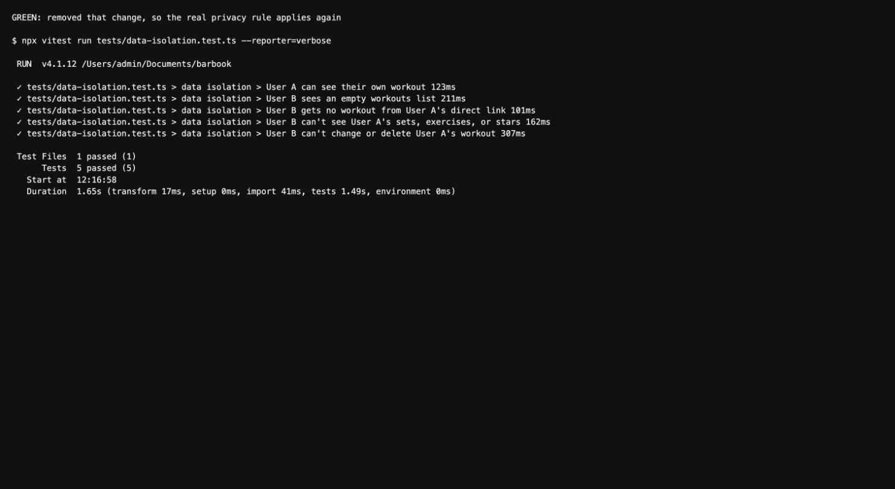
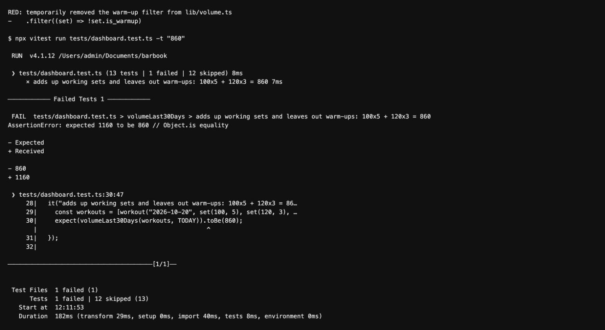
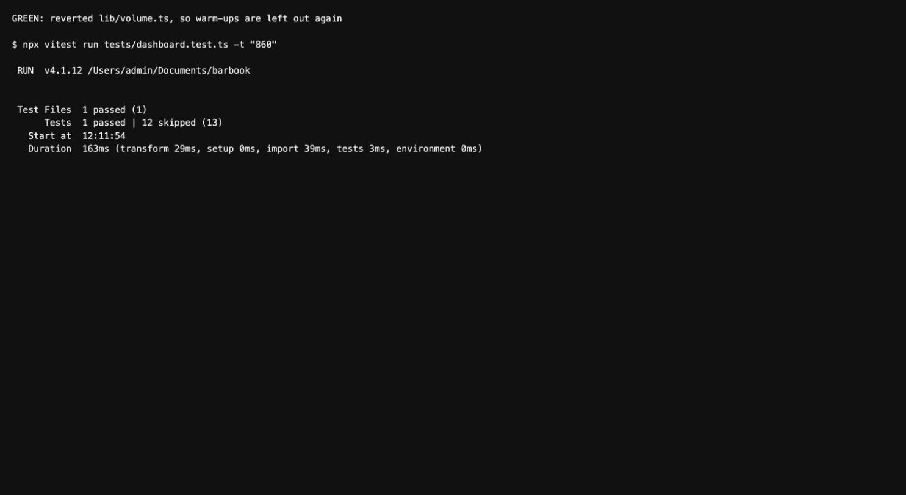

# Barbook

A free training log for powerlifters. Log every set, follow a program, get suggested weights, and see your progress over time.

**Live app:** https://barbook-six.vercel.app

I built Barbook because, since I stopped competing, I've lost the coaching apps that built my workouts and suggested my numbers. My training ended up spread across different systems, and I didn't want to pay for an app.

## What it does

- **Accounts:** sign up, log in, and log out. Your data is private to your account.
- **Log workouts:** add exercises and sets with weight, reps, and RPE. Then view, edit, or delete them.
- **Workout mode:** tap ✓ after a set and your rest timer starts. Your entries are saved on the device if the page reloads.
- **Programs:** choose a 4-day program, see what's next, and switch when you want. Each program says where it comes from.
- **Templates:** save sessions you repeat and start a workout from them.
- **Suggested weights:** programs and templates fill in a weight based on your logged sets, and you can change it.
- **Exercise details:** see the muscles and equipment for each of the 34 starter exercises.
- **Find workouts:** search by exercise, muscle, or title, filter by exercise, and sort by date or volume. Star the ones worth coming back to.
- **Dashboard:** estimated 1-rep max, recent records, weekly volume, sessions per week, sets per muscle, and strength relative to bodyweight.
- **Light and dark mode:** use the switch in the top bar.

## How to use it

1. Go to the [live app](https://barbook-six.vercel.app) and create an account.
2. Open **Program** and choose a program, or tap **Start workout** on the Workouts page for an empty workout.
3. Log your sets. Tap ✓ after each one to start your rest, then tap **Finish workout**.
4. To add a past workout, open **Date and details** to set its date. You don't need to tap ✓ on its sets.

Weights are in pounds. Estimated maxes and suggested weights are calculated from what you log, so they aren't coaching advice.

## Tools used

| Tool | What it does here |
|---|---|
| [Claude Code](https://claude.com/claude-code) | The coding agent, working through Issues, branches, and pull requests |
| [Next.js](https://nextjs.org) and TypeScript | Pages and app logic |
| [Neon](https://neon.tech) Postgres | The database, with Row Level Security keeping each user's rows private |
| Neon Managed Better Auth | Sign up and login |
| [Vercel](https://vercel.com) | Hosting, redeploying when a PR merges to `main` |
| Tailwind CSS and shadcn/ui | Styling and components |
| Recharts | Dashboard charts |
| Zod | Validation rules and messages |
| Vitest | Tests |

## How to run it

You need Node.js and a Neon project with Data API and Auth turned on.

```bash
git clone https://github.com/kureemn/barbook.git
```

```bash
cd barbook
```

```bash
npm install
```

```bash
cp .env.example .env.local
```

Fill in `.env.local` from the Neon Console. Keep `DATABASE_URL` private: never commit it, give it a `NEXT_PUBLIC_` prefix, or add it to Vercel.

Set up the database:

```bash
npm run db:migrate
```

Then click **Refresh schema cache** on the Neon Console's Data API page. Until you do, the Data API rejects queries that use new tables.

In Neon Auth, allow `http://localhost:3000` so login works locally. Then start the app:

```bash
npm run dev
```

It runs at http://localhost:3000.

### Checks

| Command | What it checks |
|---|---|
| `npm test` | All tests. The data isolation test needs `DATABASE_URL` in `.env.local`. |
| `npm run db:verify` | Privacy rules and database constraints, in a transaction that's always rolled back |
| `npm run lint` | Code style |

## The two required tests

### Data isolation

`tests/data-isolation.test.ts`

**In plain English:** given User A has logged a workout, when User B asks for the workouts list or opens that workout's direct link, User B gets an empty list and no workout. The test also checks that User A can see it, so it can't pass just because nothing was saved. It runs against the real database rules with two made-up users, and everything is undone afterward.

**What would break it:** turning off Row Level Security on `workouts`, or rewriting its select rule so it no longer checks `user_id`. Any signed-in user could then read everyone's workouts.

| Red | Green |
|---|---|
|  |  |

For the red run, I replaced the privacy rule on workouts inside the test's transaction, so anyone could read any workout.

### Dashboard

`tests/dashboard.test.ts`

**In plain English:** given working sets of 100×5 and 120×3 and a warm-up of 60×5 in the last 30 days, the 30-day volume must be 860 (500 + 360). The warm-up doesn't count.

**What would break it:** changing `workoutVolume` so warm-ups count toward volume. That would inflate the numbers on the dashboard and workout pages.

| Red | Green |
|---|---|
|  |  |

For the red run, I temporarily removed the warm-up filter, and the test reported 1160 instead of 860.

The screenshots show real test output, saved as text and opened in a browser to capture it.

## Project docs

- [PLAN.md](PLAN.md): the original plan, with Plan vs. Reality at the end
- [schema.md](schema.md): the database tables, and how they compare with the plan
- [prompts/](prompts/): the key prompts for each feature
- [Pull requests](https://github.com/kureemn/barbook/pulls?q=is%3Apr+is%3Aclosed): one for each change, each linked to an Issue
