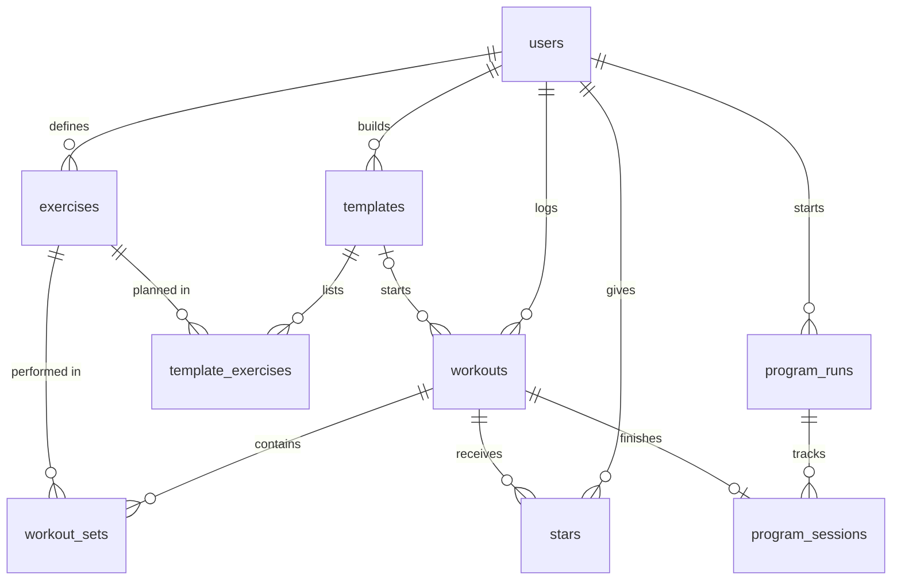

# Barbook database

This describes what's in the database now. Tables arrive with the feature that needs them, and PLAN.md section 3 has the full design.

## Tables

### users (`neon_auth."user"`)

Created and managed by Neon Auth, in its own schema. Every account is one row.

| Column | Type | Notes |
|---|---|---|
| `id` | uuid | Primary key |
| `name` | text | |
| `email` | text | |
| `createdAt`, `updatedAt` | timestamp | |

It also has auth-only columns, such as `emailVerified`, `image`, and `role`.

### exercises

The lifts a user trains.

| Column | Type | Notes |
|---|---|---|
| `id` | uuid | Primary key |
| `user_id` | uuid | Owner, links to users |
| `name` | text | Required, unique per user |
| `category` | text | squat, bench, deadlift, or accessory |
| `created_at` | timestamp | |

### workouts

One training session on one date.

| Column | Type | Notes |
|---|---|---|
| `id` | uuid | Primary key |
| `user_id` | uuid | Owner, links to users |
| `title` | text | Required |
| `performed_on` | date | Required |
| `bodyweight` | number | Optional |
| `notes` | text | Optional |
| `template_id` | uuid | Optional, links to the template it started from |
| `created_at` | timestamp | |

### workout_sets

One row per set. Weights are in pounds.

| Column | Type | Notes |
|---|---|---|
| `id` | uuid | Primary key |
| `user_id` | uuid | Owner, links to users |
| `workout_id` | uuid | Links to workouts |
| `exercise_id` | uuid | Links to exercises |
| `set_number` | number | Above 0 |
| `weight` | number | 0 or more |
| `reps` | number | Above 0 |
| `rpe` | number | Optional, 6 to 10 |
| `is_warmup` | true/false | Defaults to false |

### stars

One table for everyone. Each row means "this user starred this workout".

| Column | Type | Notes |
|---|---|---|
| `user_id` | uuid | Part of the primary key, links to users |
| `workout_id` | uuid | Part of the primary key, links to workouts |
| `created_at` | timestamp | |

### templates

A reusable program day.

| Column | Type | Notes |
|---|---|---|
| `id` | uuid | Primary key |
| `user_id` | uuid | Owner, links to users |
| `name` | text | Required |
| `notes` | text | Optional |
| `created_at` | timestamp | |

### template_exercises

One row per exercise in a template, with its targets.

| Column | Type | Notes |
|---|---|---|
| `id` | uuid | Primary key |
| `user_id` | uuid | Owner, links to users |
| `template_id` | uuid | Links to templates |
| `exercise_id` | uuid | Links to exercises |
| `position` | number | Order in the template, above 0 |
| `target_sets` | number | 1 to 20 |
| `target_reps` | number | Above 0 |
| `target_rpe` | number | Optional, 6 to 10 |

### program_runs

One row each time a lifter starts a program. The weeks, days, and targets live in `lib/programs.ts`, because they're the same for everyone. Only one run per user can be active.

| Column | Type | Notes |
|---|---|---|
| `id` | uuid | Primary key |
| `user_id` | uuid | Owner, links to users |
| `program_key` | text | Which built-in program: `six-week-strength`, `five-three-one-bbb`, or `phul` |
| `started_on` | date | Required |
| `ended_on` | date | Empty while the program is running |
| `created_at` | timestamp | |

### program_sessions

One row per finished session, connecting a run to the workout logged for it.

| Column | Type | Notes |
|---|---|---|
| `id` | uuid | Primary key |
| `user_id` | uuid | Owner, links to users |
| `run_id` | uuid | Links to program_runs |
| `week` | number | 1 to 6 |
| `day` | number | 1 to 4 |
| `workout_id` | uuid | Links to workouts, and each workout can finish only one session |

## How they relate

- A user has many exercises, workouts, and templates (one-to-many).
- A workout has many sets, and an exercise appears in many sets (one-to-many each). Together, `workout_sets` connects workouts and exercises many-to-many.
- `stars` connects users and workouts many-to-many, as a junction table. A user can star a workout only once, and only their own.
- Deleting a workout deletes its sets and stars. An exercise that has sets can't be deleted.
- A template has many template exercises, and a workout can optionally come from one template.
- Deleting a template deletes its template exercises. Workouts started from it stay, with `template_id` cleared. An exercise used in a template can't be deleted.
- A set's workout and exercise must have the same owner as the set, and the same applies to template exercises and a workout's template.
- A program run has many program sessions, and a run can log each week and day only once. Deleting a workout deletes its session row, which reopens that session. Ending a run keeps it and its workouts as history.
- A session's run and workout must have the same owner as the session.

## Who can see what

Row Level Security is on for every table in `public`. A signed-in user can only read, add, change, or delete rows where `user_id` is their own. Logged-out visitors get nothing. Run `npm run db:verify` to check this.

Access is opt-in. New tables get no automatic access, so each one needs its own grant in `db/schema.sql`, next to its Row Level Security rules. `db:verify` fails if a table in `public` is missing Row Level Security, or if new tables start getting automatic access.

## Changing the database

1. Update `db/schema.sql`, then run `npm run db:migrate`.
2. Click **Refresh schema cache** on the Neon Console's Data API page. Until then, the Data API rejects queries that use new tables.
3. Run `npm run db:verify`.
4. Merge the app code that uses the change.

## Did the agent build what I designed?

Yes. All seven planned tables exist with the planned columns and connections, and the many-to-many links work as designed through `workout_sets` and `stars`. Here's what differs from PLAN.md section 3:

| Planned | Built | Why |
|---|---|---|
| `users` is a regular table | Lives in Neon Auth's `neon_auth` schema | Neon Auth creates and manages it |
| IDs are text | `uuid` | Neon Auth's user id is a uuid, and the database can validate it |
| `created_at` is a date | Date and time | Keeps the exact moment a row was created |
| `template_exercises.target_sets` is any number | Limited to 1 to 20 | Starting a workout creates one row per target set, so this keeps the form usable |
| No program tables | Added `program_runs` and `program_sessions` | I added programs after the plan. They record which program I'm on and which workout finished each session |
| Programs not designed | Program details live in `lib/programs.ts`, not tables | The weeks and targets are the same for everyone, so only each lifter's progress needs storing |

Two things the agent added that the plan didn't spell out:

- **Ownership checks:** a set's workout and exercise must have the same owner as the set, using two-column foreign keys. The plan only listed `user_id` columns.
- **Automatic privacy:** Row Level Security is on for every table, and new tables get no access until they're granted it. The plan named Row Level Security in section 5, but section 3 didn't show the rules.
